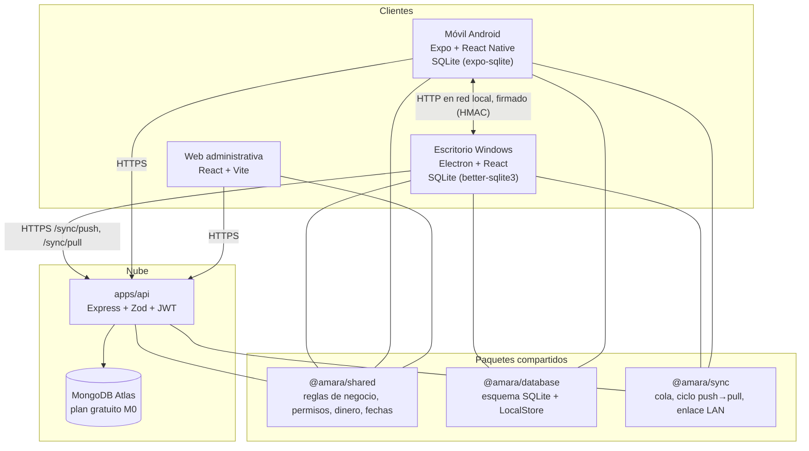
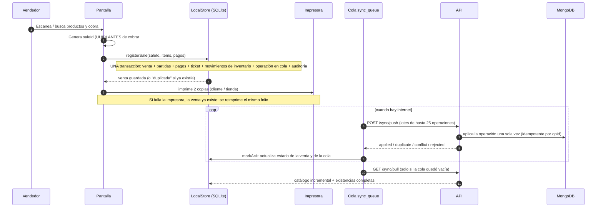
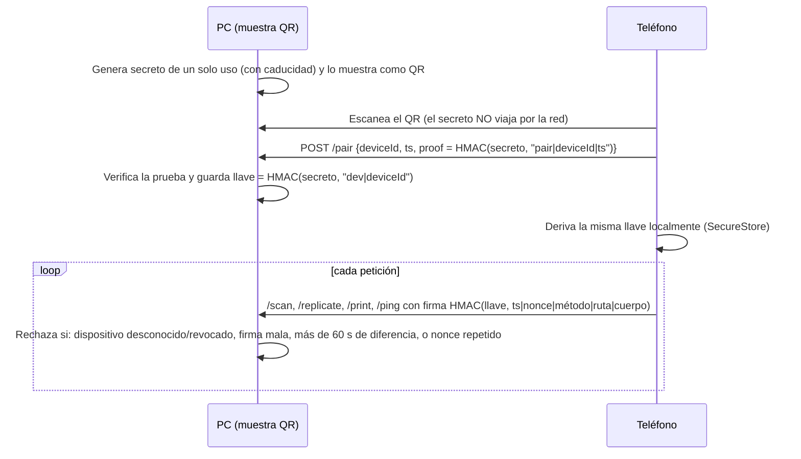
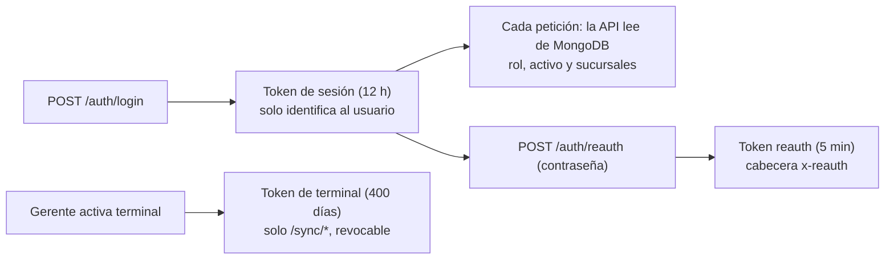

# Arquitectura

> Revisión: 22/10/2026. Describe el diseño que se desprende del código de `packages/*` y `apps/api/src`. Lo que corresponde a `apps/desktop`, `apps/mobile` y `apps/web` (escritos en paralelo) se marca como **por confirmar**. Nada de esto ha sido ejecutado todavía (ver [README](../README.md), sección 0).

## 1. Principios de diseño

1. **Primero se guarda local, después se envía.** Escritorio y móvil guardan cada venta en su SQLite dentro de una sola transacción. Solo después de ese guardado se le dice al operador que la venta quedó registrada.
2. **Se sincronizan eventos, no cantidades.** Lo que viaja es "se vendió esto", "entró esto", "se cerró la caja", nunca "ahora hay 7 unidades".
3. **Cada evento tiene un identificador único (`opId`)**, así que enviarlo dos veces no lo duplica.
4. **El servidor manda en los permisos.** Los clientes solo muestran u ocultan botones; la API vuelve a validar rol y sucursales en cada petición.
5. **Lo ocurrido no se borra.** Ventas, partidas, pagos, tickets, movimientos y auditoría están protegidos; las correcciones son registros nuevos.
6. **No se depende de transacciones multi-documento de MongoDB** (no se pudo confirmar su disponibilidad en el plan gratuito). La consistencia se logra con identificadores únicos, incrementos atómicos y movimientos como fuente de verdad.

## 2. Vista general



Los paquetes `shared`, `database` y `sync` son **la misma lógica** en todas las aplicaciones: así un total, un folio o un permiso se calculan igual en la PC, el teléfono y el servidor. El adaptador de SQLite cambia según la plataforma (`fromSyncSqlite` para `better-sqlite3`/`node:sqlite`, `fromExpoSqlite` para el móvil), pero las tablas y reglas son las mismas.

## 3. Qué vive en cada lugar

| Dato | SQLite (PC/teléfono) | MongoDB (nube) |
|---|---|---|
| Catálogo (productos, variantes) | Copia de lectura, se actualiza con cada `pull` | **Fuente de verdad** |
| Existencias | `stock.base_qty` (última cifra del servidor) + movimientos locales aún no confirmados | `stock` (incrementos atómicos) + `inventory_movements` |
| Ventas, partidas, pagos | Se crean aquí primero | Llegan por `sync/push` |
| Tickets (copia exacta) | Tabla `tickets` | Se reconstruyen de la venta |
| Caja (sesiones y movimientos) | Se crean aquí primero | Llegan por `sync/push` |
| Usuarios | `users_local` (sin contraseña; solo un verificador derivado tras iniciar sesión en línea) | `users` (hash scrypt) |
| Permisos temporales | `grants_local` (copia con fecha de descarga) | `grants` |
| Transferencias entre sucursales | **No hay tabla local** (solo en línea) | `transfers` |
| Auditoría | `audit_log` local (protegida) | `audit_log` |
| Respaldos | `backups_log` | `backups_log` |

## 4. Flujo de una venta



Detalles verificados en `packages/database/src/local-store.ts`:

- El `saleId` lo genera la pantalla antes de cobrar; si se pulsa dos veces el botón o se reintenta, `registerSale` devuelve la venta existente con `duplicate: true` y no escribe nada más.
- La transacción es `BEGIN IMMEDIATE … COMMIT`, y el acceso a SQLite está serializado con un candado: dos ventas simultáneas nunca se mezclan.
- SQLite se abre con `journal_mode=WAL` y `synchronous=FULL` (`OPEN_PRAGMAS`), de modo que cada `COMMIT` queda en disco aunque se vaya la luz. *(Que la aplicación de escritorio realmente aplique estos PRAGMAs al abrir la base es algo por confirmar en `apps/desktop`.)*
- Si no hay caja abierta, la venta se rechaza (`caja_cerrada`) salvo que la configuración `require_open_cash` sea `0`.
- Una venta que deja la existencia local negativa **no se bloquea**: se guarda y se devuelve una advertencia.

## 5. Existencias: cómo se calculan

```text
cantidad visible = stock.base_qty            (última cifra descargada del servidor)
                 + SUM(delta) de inventory_movements con synced = 0   (lo local aún no confirmado)
```

- Un `pull` solo reemplaza `base_qty`; **nunca borra los movimientos locales pendientes**, así que no se "restauran" cifras viejas de la mañana.
- Cuando el servidor confirma una operación, sus movimientos pasan a `synced = 1` y dejan de sumarse.
- Efecto secundario conocido: entre la confirmación y el siguiente `pull` exitoso, la cifra mostrada puede ser **temporalmente mayor** a la real (el movimiento ya no se suma pero `base_qty` aún es la cifra anterior). El ciclo hace el `pull` inmediatamente después, así que normalmente dura segundos; si justo se cae internet, puede durar hasta el siguiente ciclo. Ver [SINCRONIZACION.md](SINCRONIZACION.md).

## 6. Modo teléfono–PC (red local)



Puerto por defecto: `47880` (`LAN_PORT`). **El enlace local va en HTTP sin cifrar**: nadie puede falsificar órdenes sin la llave, pero el contenido es visible en la red. Por eso no debe usarse con redes Wi-Fi públicas ni enviar secretos por ahí.

## 7. Autenticación en la API



Como el rol se lee de la base en cada petición, **cambiar un rol o desactivar a un usuario surte efecto de inmediato** en la API, aunque el usuario conserve un token.

## 8. Tecnologías (según `package.json`)

| Capa | Tecnología |
|---|---|
| API | Node.js ≥ 20, Express 4, Helmet, CORS, express-rate-limit, `jose` (JWT), `mongodb` 6, Zod, scrypt (`@noble/hashes`) |
| Empaquetado de la API | `tsup` (`npm run build -w @amara/api`) |
| Paquetes compartidos | TypeScript 5.6, Zod 3, `@noble/hashes` |
| Pruebas | Ejecutor integrado `node:test`, `node:sqlite` |
| Escritorio / móvil / web | **Por confirmar** en el `package.json` de cada app |

## 9. Zona horaria

El negocio opera en `America/Mexico_City`. Para que el cálculo sea idéntico en el servidor, Windows y Android, el código usa un desfase **fijo de UTC−06:00** (`MX_OFFSET_MIN = -360`), válido desde que México eliminó el horario de verano (octubre de 2022). Si México volviera a cambiar de horario, hay que modificar esa constante en `packages/shared/src/time.ts`. Los límites de un "día" son 00:00 → 24:00 de ese desfase.

## 10. Límites conocidos del diseño

- Una terminal desconectada **no puede conocer** las ventas de otra terminal desconectada. Los resúmenes locales siempre se marcan como "pueden estar incompletos".
- El reloj de cada dispositivo decide la hora de sus operaciones (`localTs`) y la vigencia local de permisos temporales. Un reloj mal puesto afecta ambas cosas.
- Las altas y ediciones de **catálogo** y las **transferencias** solo se hacen en línea (no existen como operaciones de la cola: `OpType` solo contiene `sale.create`, `sale.adjust`, `stock.movement`, `cash.open`, `cash.movement`, `cash.close`).
