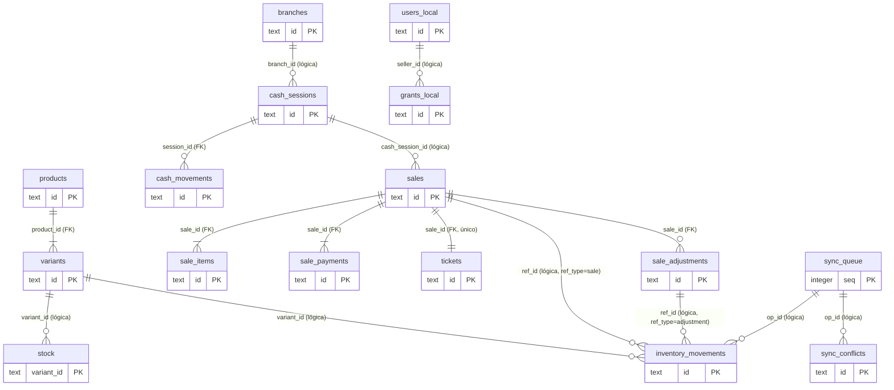
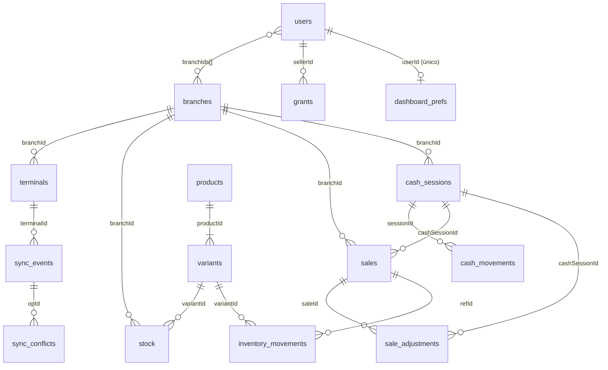

# Diccionario de datos

> Revisión: 22/10/2026.
> - **Parte A (SQLite local)** está extraída línea por línea de `packages/database/src/schema.ts` (migración 1, `esquema_inicial`) y de las consultas de `packages/database/src/local-store.ts`. Es exacta respecto al código.
> - **Parte B (MongoDB central)**: los **índices y restricciones** están extraídos de `apps/api/src/db.ts`; los **campos** se tomaron de las escrituras reales del código de la API (`seed.ts`, `routes/*.ts`, `sync-apply.ts`, `sync-repo.ts`, `stock.ts`, `audit.ts`) y de los tipos de `packages/shared`. Donde un campo solo se deduce del tipo compartido y no se vio una escritura en la API, se marca **(tipo)**. La API **no se ha ejecutado** contra una base real, así que el contenido real de los documentos podría diferir en detalles.
> - **Núcleo v2**: la migración 2 (`v2_vendedor_extras_tokens_ajustes`, `packages/database/src/schema.ts`) y las colecciones/campos nuevos de la API están marcados con **v2**. La migración 1 no se tocó: la 2 es solo aditiva y se probó sobre datos de la versión 1.
> - Nada se ha ejecutado todavía contra una base real; ver [README](../README.md), sección 0.

## Convenciones generales

| Tema | Regla |
|---|---|
| Dinero | Entero en **centavos de MXN** (`*_cents` en SQLite, `*Cents` en MongoDB/TypeScript). Nunca decimales. |
| Fechas | Texto ISO-8601 en **UTC** con milisegundos y `Z` (p. ej. `2026-10-22T16:00:00.000Z`). Se muestran en hora de México. |
| Identificadores | **UUID v4** generado por el dispositivo que crea el registro. En MongoDB, `_id` = ese UUID (texto) y se repite en `id`. |
| Cantidades de producto | Enteros (unidades). |
| Booleanos en SQLite | `INTEGER` 0/1. |
| JSON en SQLite | Columnas `*_json` guardan texto JSON. |
| Estados | Textos en español, restringidos con `CHECK` en SQLite. |

---

# PARTE A — SQLite local (escritorio y móvil)

La base se abre con (`OPEN_PRAGMAS`): `journal_mode = WAL`, `synchronous = FULL`, `foreign_keys = ON`, `busy_timeout = 5000`.
Las migraciones se registran en `schema_migrations` (creada por `LocalStore.migrate()`); hoy solo existe la **versión 1**. Cada migración se aplica dentro de una transacción y **nunca se edita una ya publicada**.

## A.1 Diagrama entidad-relación (SQLite)

"FK" = llave foránea declarada en SQLite (con `foreign_keys = ON`). "Lógica" = relación por identificador sin `REFERENCES` declarado.

## A.2 Tablas

### `meta` — configuración y estado del dispositivo
**Finalidad:** pares clave/valor (equivale a la "configuración" local).

| Campo | Tipo | Oblig. | Predet. | Notas |
|---|---|---|---|---|
| `key` | TEXT | Sí | — | **PK** |
| `value` | TEXT | No | — | |

Claves usadas por el código: `branch_id`, `branch_code`, `terminal_id`, `terminal_code` (identidad de la terminal; `setDeviceInfo`), `last_pull_at` (hora del servidor del último `pull`; se usa como `since`), `last_sync_ok_at`, `require_open_cash` (`'0'` permite vender sin caja abierta; cualquier otro valor o ausencia = exige caja), `last_backup_<tipo>_at` (último respaldo correcto por tipo).
**Actualización:** `INSERT … ON CONFLICT DO UPDATE` (se puede cambiar). Sin triggers.

### `schema_migrations` — versiones aplicadas
`version INTEGER PK`, `name TEXT NOT NULL`, `applied_at TEXT NOT NULL`. Solo se agregan filas.

### `branches` — sucursales (copia del servidor)
| Campo | Tipo | Oblig. | Predet. | Notas |
|---|---|---|---|---|
| `id` | TEXT | Sí | — | PK |
| `code` | TEXT | Sí | — | Código corto (se usa en el folio) |
| `name` | TEXT | Sí | — | |
| `status` | TEXT | Sí | `'activa'` | |
| `locations_json` | TEXT | Sí | `'[]'` | Lista JSON de ubicaciones |

**Actualización:** solo por `applyPull` (upsert). El dispositivo no crea sucursales.

### `users_local` — usuarios conocidos por el dispositivo
| Campo | Tipo | Oblig. | Predet. | Notas |
|---|---|---|---|---|
| `id` | TEXT | Sí | — | PK |
| `username` | TEXT | Sí | — | **UNIQUE** |
| `name` | TEXT | Sí | — | |
| `role` | TEXT | Sí | — | `CHECK` en `gerente`, `vendedor`, `desarrollador` |
| `branch_ids_json` | TEXT | Sí | `'[]'` | Sucursales autorizadas |
| `active` | INTEGER | Sí | `1` | |
| `verifier` | TEXT | No | NULL | Hash derivado **tras un inicio de sesión en línea**; **nunca** la contraseña. Permite entrar sin internet. |
| `updated_at` | TEXT | Sí | — | |

**v2:** en los **gerentes**, el `pull` trae el campo `verifier` (el hash scrypt de su contraseña, ya existente en el servidor) y se guarda aquí para poder validar la contraseña de un administrador SIN internet al autorizar cierres, cancelaciones, devoluciones y Limpias. Si el `pull` no lo trae, se conserva el anterior (`COALESCE`).
**Reglas:** el `pull` actualiza todos los campos; `verifier` solo cuando viene informado. `getUserByUsername` solo devuelve usuarios con `active = 1`. El rol `desarrollador` existe aquí pero la app de escritorio no debe ofrecerlo para entrar al punto de venta (`DESKTOP_ROLES`).

### `products` — catálogo: producto
| Campo | Tipo | Oblig. | Predet. | Notas |
|---|---|---|---|---|
| `id` | TEXT | Sí | — | PK |
| `name` | TEXT | Sí | — | Índice `idx_products_name` |
| `type` | TEXT | Sí | — | Tipo de producto |
| `category` | TEXT | Sí | — | |
| `description` | TEXT | No | NULL | |
| `brand` | TEXT | No | NULL | |
| `sku` | TEXT | Sí | — | Índice `idx_products_sku` (no único en local; la unicidad la impone el servidor) |
| `photo` | TEXT | No | NULL | Imagen reducida (data URL) |
| `specs_json` | TEXT | Sí | `'{}'` | Especificaciones libres clave→valor |
| `status` | TEXT | Sí | `'activo'` | `CHECK` en `activo`, `archivado` |
| `created_at` / `updated_at` | TEXT | Sí | — | |

**Actualización:** solo por `applyPull` (upsert). Un producto **archivado** sigue existiendo (para tickets y duplicados) pero `registerSale`, `findByCode`, `search` e `inventoryList` lo excluyen.

### `variants` — catálogo: tamaño / presentación
| Campo | Tipo | Oblig. | Predet. | Notas |
|---|---|---|---|---|
| `id` | TEXT | Sí | — | PK |
| `product_id` | TEXT | Sí | — | **FK → `products(id)`**; índice `idx_variants_product` |
| `label` | TEXT | Sí | — | "Chica", "Grande"… |
| `unit` | TEXT | Sí | `'pieza'` | |
| `barcode` | TEXT | No | NULL | Código comercial (EAN/UPC…); índice `idx_variants_barcode` (no único en local) |
| `internal_code` | TEXT | Sí | — | **ÚNICO** (`idx_variants_internal`). Formato `AMA` + 8 dígitos (Code 128) |
| `qr_value` | TEXT | Sí | — | `amara:v1:<id de la variante>`; identifica, no contiene secretos |
| `cost_cents` | INTEGER | Sí | — | `CHECK >= 0` |
| `price_cents` | INTEGER | Sí | — | `CHECK >= 0` |
| `min_stock` | INTEGER | Sí | `0` | Umbral de "pocas existencias" |
| `location` | TEXT | No | NULL | Ubicación predeterminada |
| `status` | TEXT | Sí | `'activo'` | `CHECK` en `activo`, `archivado` |
| `updated_at` | TEXT | Sí | — | |

**Actualización:** solo por `applyPull`. El `pull` del catálogo es incremental (por `updated_at`).

### `stock` — existencia conocida del servidor (base)
| Campo | Tipo | Oblig. | Predet. | Notas |
|---|---|---|---|---|
| `variant_id` | TEXT | Sí | — | **PK compuesta** (`variant_id`, `branch_id`) |
| `branch_id` | TEXT | Sí | — | |
| `base_qty` | INTEGER | Sí | `0` | Cantidad que dijo el servidor en el último `pull` |
| `location` | TEXT | No | NULL | |
| `updated_at` | TEXT | Sí | — | |

**Regla clave:** la cantidad visible = `base_qty` + suma de `delta` de `inventory_movements` con `synced = 0`. **Nunca se modifica `base_qty` por una venta.** Solo el `pull` la reemplaza. `registerMovement` crea la fila con `INSERT OR IGNORE … base_qty = 0` si no existía.

### `cash_sessions` — sesiones de caja (apertura → corte)
| Campo | Tipo | Oblig. | Predet. | Notas |
|---|---|---|---|---|
| `id` | TEXT | Sí | — | PK |
| `branch_id` | TEXT | Sí | — | |
| `terminal_id` | TEXT | Sí | — | |
| `opened_by` | TEXT | Sí | — | Usuario que abrió |
| `opened_at` | TEXT | Sí | — | |
| `opening_cents` | INTEGER | Sí | — | Fondo inicial, `CHECK >= 0` |
| `status` | TEXT | Sí | `'abierta'` | `CHECK` en `abierta`, `cerrada` |
| `closed_by`, `closed_at` | TEXT | No | NULL | Quién y cuándo cerró |
| `counted_cents` | INTEGER | No | NULL | Efectivo contado |
| `expected_cents` | INTEGER | No | NULL | Efectivo esperado calculado |
| `difference_cents` | INTEGER | No | NULL | contado − esperado (negativo = faltante) |
| `provisional` | INTEGER | Sí | `0` | 1 si se cerró con operaciones sin sincronizar o sin conexión |
| `reconciliation` | TEXT | Sí | `'n/a'` | `CHECK` en `n/a`, `pendiente`, `conciliado`, `con_diferencias` |
| `closure_json` | TEXT | No | NULL | Desglose completo del corte (importes por método, billetes y monedas) |
| `notes` | TEXT | No | NULL | |
| `close_authorization_json` | TEXT | No | NULL | **v2.** `ActionAuthorization` con que se cerró la caja. Si cierra el gerente: su propia identidad como `admin_password` |
| `close_authorized_by` | TEXT | No | NULL | **v2.** Id del administrador que autorizó el cierre (el creador del token si fue token) |

**Índices/restricciones:** índice **único parcial** `idx_one_open_session` sobre `terminal_id` donde `status = 'abierta'` → **solo una caja abierta por terminal**.
**Reglas de actualización:** nunca se borra (trigger). Una sesión **cerrada** no puede cambiar `counted_cents`, `expected_cents`, `difference_cents`, `status`, `closure_json` ni `opening_cents` (trigger `cash_closed_immutable`). Sí pueden cambiar `reconciliation` (cuando el servidor confirma el corte), `provisional` y `notes`. **v2:** `close_authorization_json` y `close_authorized_by` no se modifican una vez escritos (trigger `cash_close_auth_immutable`). **No se puede cerrar sin autorización válida** (`LocalStore.closeCash` lanza `autorizacion_requerida`).
El efectivo esperado = fondo + pagos en efectivo de la sesión + entradas − retiros − gastos − devoluciones/cancelaciones pagadas en efectivo. **Tarjeta y transferencia nunca se suman al efectivo.**

### `cash_movements` — entradas, retiros y gastos de efectivo
| Campo | Tipo | Oblig. | Notas |
|---|---|---|---|
| `id` | TEXT | Sí | PK |
| `session_id` | TEXT | Sí | **FK → `cash_sessions(id)`** |
| `type` | TEXT | Sí | `CHECK` en `entrada`, `retiro`, `gasto` |
| `amount_cents` | INTEGER | Sí | `CHECK > 0` |
| `concept` | TEXT | Sí | Mínimo 3 caracteres (lo exige `addCashMovement`) |
| `user_id` | TEXT | Sí | |
| `created_at` | TEXT | Sí | |

**Reglas:** solo se agregan; triggers impiden `UPDATE` y `DELETE`. Requiere caja abierta en la terminal.

### `sales` — ventas (encabezado)
| Campo | Tipo | Oblig. | Predet. | Notas |
|---|---|---|---|---|
| `id` | TEXT | Sí | — | PK (UUID creado antes de cobrar → idempotencia) |
| `folio` | TEXT | Sí | — | **UNIQUE**. `AMA-<sucursal><terminal>-<aammdd>-<0001>` |
| `branch_id`, `terminal_id`, `user_id`, `user_name` | TEXT | Sí | — | `user_name` es copia histórica |
| `cash_session_id` | TEXT | No | NULL | Sesión de caja al vender |
| `created_at` | TEXT | Sí | — | |
| `subtotal_cents`, `discount_cents`, `total_cents` | INTEGER | Sí | — | |
| `tendered_cents`, `change_cents` | INTEGER | Sí | `0` | Efectivo recibido y cambio |
| `status` | TEXT | Sí | `'completada'` | `CHECK` en `completada`, `cancelada` |
| `origin` | TEXT | Sí | `'local'` | `CHECK` en `local`, `lan` (`lan` = réplica recibida de un teléfono) |
| `sync_state` | TEXT | Sí | `'pendiente'` | `CHECK` en `pendiente`, `sincronizada`, `conflicto` |
| `seller_id`, `seller_name` | TEXT | No | NULL | **v2.** Quién vendió (puede no ser quien cobra en la caja). En ventas anteriores a v2 es NULL y se usa `user_id` / `user_name` |
| `sale_type` | TEXT | Sí | `'venta'` | **v2.** `CHECK` en `venta`, `limpia`. Una Limpia es una venta normal que suma al total |
| `authorization_json` | TEXT | No | NULL | **v2.** `ActionAuthorization` con que un vendedor hizo una Limpia (propósito `limpias`) |

**Índices:** `idx_sales_created(created_at)`, `idx_sales_branch_created(branch_id, created_at)`, `idx_sales_session(cash_session_id)`, **v2:** `idx_sales_type_created(sale_type, created_at)`.
**Reglas de actualización:** no se borra (trigger `sales_no_delete`). Los campos de dinero, folio, usuario, sucursal, terminal, sesión y fecha **no se pueden modificar** (trigger `sales_immutable`). Solo cambian `status` (a `cancelada`, por una cancelación), `sync_state` y `origin`. **v2:** `seller_id`, `seller_name`, `sale_type` y `authorization_json` tampoco se pueden modificar (trigger `sales_v2_immutable`).

### `sale_items` — partidas de la venta (copia histórica)
| Campo | Tipo | Oblig. | Predet. | Notas |
|---|---|---|---|---|
| `id` | TEXT | Sí | — | PK, `<saleId>:<n>` |
| `sale_id` | TEXT | Sí | — | **FK → `sales(id)`**; índice `idx_sale_items_sale` |
| `variant_id` | TEXT | Sí | — | Referencia lógica (sin FK a propósito: el catálogo puede cambiar) |
| `product_name`, `variant_label`, `sku`, `code` | TEXT | Sí | — | **Copias** de lo que se vendió |
| `qty` | INTEGER | Sí | — | `CHECK > 0` |
| `unit_price_cents`, `unit_cost_cents` | INTEGER | Sí | — | Precio y costo **al momento de la venta** |
| `line_discount_cents` | INTEGER | Sí | `0` | |
| `net_cents` | INTEGER | Sí | — | Importe final de la línea (incluye su parte del descuento general) |
| `kind` | TEXT | Sí | `'producto'` | **v2.** `CHECK` en `producto`, `extra`. Un **extra** es un cargo adicional sobre un producto (p. ej. aceite en una veladora): `qty = 1`, costo 0, **no mueve inventario**, suma al importe pero no a unidades vendidas |
| `extra_note` | TEXT | No | NULL | **v2.** Texto libre del extra ("Aceite de lavanda") |

**Reglas:** triggers impiden `UPDATE` y `DELETE`. Un cambio posterior de precio o nombre en el catálogo **no** altera estas filas.

### `sale_payments` — pagos de la venta
| Campo | Tipo | Oblig. | Notas |
|---|---|---|---|
| `id` | TEXT | Sí | PK, `<saleId>:p<n>` |
| `sale_id` | TEXT | Sí | **FK → `sales(id)`**; índice `idx_sale_payments_sale` |
| `method` | TEXT | Sí | `CHECK` en `efectivo`, `tarjeta`, `transferencia`, `otro` |
| `amount_cents` | INTEGER | Sí | `CHECK > 0`. Importe aplicado a la venta (ya sin cambio) |
| `tendered_cents`, `change_cents` | INTEGER | No | Solo efectivo |

**Reglas:** triggers impiden `UPDATE`/`DELETE`. La suma de pagos debe igualar el total (`computeSale`); solo se admite un pago en efectivo por venta.

### `tickets` — copia del ticket tal como se emitió
| Campo | Tipo | Oblig. | Predet. | Notas |
|---|---|---|---|---|
| `id` | TEXT | Sí | — | PK |
| `sale_id` | TEXT | Sí | — | **UNIQUE**, FK → `sales(id)` |
| `folio` | TEXT | Sí | — | **UNIQUE** |
| `payload_json` | TEXT | Sí | — | Contenido del ticket (`TicketPayload`) |
| `printed_customer_at`, `printed_store_at` | TEXT | No | NULL | Cuándo se imprimió cada copia |
| `print_count` | INTEGER | Sí | `0` | |
| `last_print_error` | TEXT | No | NULL | Último error de impresión |

**Reglas:** `payload_json`, `folio` y `sale_id` son inmutables; no se borra. Los campos de impresión sí se actualizan (`markPrinted`, `recordPrintFailure`). Al mostrar el ticket, el `status` se toma de la venta (así una cancelación se refleja sin reescribir el original).
**Nota:** el nombre de sucursal del ticket de una venta recibida por réplica LAN se guarda con el *id* de la sucursal (ver "Inconsistencias" al final).

### `sale_adjustments` — cancelaciones y devoluciones
| Campo | Tipo | Oblig. | Predet. | Notas |
|---|---|---|---|---|
| `id` | TEXT | Sí | — | PK |
| `sale_id` | TEXT | Sí | — | **FK → `sales(id)`**; índice `idx_adj_sale` |
| `branch_id`, `terminal_id`, `user_id` | TEXT | Sí | — | |
| `type` | TEXT | Sí | — | `CHECK` en `cancelacion`, `devolucion` |
| `created_at` | TEXT | Sí | — | Índice `idx_adj_created` |
| `reason` | TEXT | Sí | — | Mínimo 3 caracteres |
| `amount_cents` | INTEGER | Sí | — | `CHECK >= 0` |
| `payments_json` | TEXT | Sí | — | Cómo se devolvió el dinero (método e importe) |
| `items_json` | TEXT | Sí | — | Partidas devueltas, con `restock` (si regresan a existencias) |
| `cash_session_id` | TEXT | No | NULL | Caja de la que sale el efectivo devuelto |
| `sync_state` | TEXT | Sí | `'pendiente'` | `CHECK` en `pendiente`, `sincronizada`, `conflicto` |
| `authorization_json` | TEXT | No | NULL | **v2.** Autorización con que un vendedor canceló/devolvió |
| `authorized_by` | TEXT | No | NULL | **v2.** Id del administrador que autorizó (el gerente que lo hace él mismo queda aquí) |

**Reglas:** no se borra; `id`, `sale_id`, `type`, `created_at`, `amount_cents`, `payments_json`, `items_json`, `user_id` son inmutables. Una cancelación solo procede si la venta está `completada` y **no tiene devoluciones previas**; las devoluciones parciales usan redondeo acumulado para que la suma nunca exceda el neto de la línea. Se exige caja abierta si se devuelve efectivo. **v2:** `authorization_json` y `authorized_by` son inmutables (trigger `adj_v2_immutable`). Un extra devuelto o cancelado regresa dinero pero **no** existencias (`restock = false`; en `items_json` cada partida lleva `kind`).

### `inventory_movements` — historial de inventario (fuente de verdad local)
| Campo | Tipo | Oblig. | Predet. | Notas |
|---|---|---|---|---|
| `id` | TEXT | Sí | — | PK. Ventas: `<saleId>:m<n>`; ajustes: `<adjId>:m<n>`; manuales: UUID del formulario |
| `variant_id`, `branch_id` | TEXT | Sí | — | |
| `delta` | INTEGER | Sí | — | **Con signo** |
| `type` | TEXT | Sí | — | `entrada`, `salida`, `ajuste`, `venta`, `devolucion`, `conteo` (y `transferencia_*` en el tipo `MovementType`); sin `CHECK` |
| `reason` | TEXT | Sí | — | |
| `ref_type`, `ref_id` | TEXT | No | NULL | `sale` / `adjustment` y su id |
| `user_id` | TEXT | Sí | — | Quién lo hizo |
| `authorized_by`, `grant_id` | TEXT | No | NULL | Gerente y permiso temporal que lo autorizó |
| `location` | TEXT | No | NULL | |
| `created_at` | TEXT | Sí | — | |
| `op_id` | TEXT | No | NULL | Operación de la cola que lo envía |
| `synced` | INTEGER | Sí | `0` | 0 = aún suma a la cantidad visible; 1 = ya incluido en la base del servidor |

**Índices:** `idx_mov_variant(variant_id, branch_id, synced)`, `idx_mov_op(op_id)`.
**Reglas:** no se borra; `id`, `variant_id`, `branch_id`, `delta`, `type`, `reason`, `user_id`, `created_at` son inmutables. Solo `synced` (y metadatos) cambian. `conteo` guarda la **diferencia** (contado − visible), no pisa la existencia.

### `security_tokens_cache` — tokens de seguridad descargados (**v2**)
**Finalidad:** validar un token SIN internet. Se llena en cada `pull` (`applyPull`); solo guarda `salt` y `hash`, nunca el código.

| Campo | Tipo | Oblig. | Predet. | Notas |
|---|---|---|---|---|
| `id` | TEXT | Sí | — | PK (id del token en el servidor) |
| `label` | TEXT | Sí | `''` | Nombre que le puso el gerente |
| `hash`, `salt` | TEXT | Sí | — | `sha256(salt:CODIGO)` y su sal |
| `purposes` | TEXT | Sí | `'[]'` | JSON: `cierre_caja`, `devolucion`, `cancelacion`, `limpias` |
| `branch_id` | TEXT | No | NULL | NULL = cualquier sucursal |
| `for_user_id` | TEXT | No | NULL | Si viene, solo ese usuario puede usarlo |
| `created_by`, `created_at` | TEXT | No | NULL | |
| `expires_at` | TEXT | Sí | — | Índice `idx_tokens_cache_expires` |
| `revoked_at` | TEXT | No | NULL | |
| `max_uses` | INTEGER | No | NULL | NULL = ilimitado |
| `used_count` | INTEGER | Sí | `0` | |
| `fetched_at` | TEXT | No | NULL | Cuándo se descargó |

**Reglas:** el `pull` reemplaza la caché con lo que manda el servidor. Un uso sin conexión no se cuenta aquí: el servidor lo cuenta al sincronizar la operación (`authorization.tokenId`).

### `app_settings` — configuración sincronizada (**v2**)
`key TEXT PK`, `value TEXT NOT NULL` (JSON), `updated_at TEXT NOT NULL`. Clave usada: `extraCategories` (arreglo de categorías que admiten "Extra"; por omisión Veladoras, Pulseras, Imágenes, Lociones). Se actualiza con el `pull` (`settings.extraCategories`). Distinta de `meta`, que es identidad y estado del dispositivo.

### `sync_queue` — cola persistente de sincronización
| Campo | Tipo | Oblig. | Predet. | Notas |
|---|---|---|---|---|
| `seq` | INTEGER | Sí | autoincremental | **PK**; define el orden de envío |
| `op_id` | TEXT | Sí | — | **UNIQUE** → clave de idempotencia |
| `type` | TEXT | Sí | — | `sale.create`, `sale.adjust`, `stock.movement`, `cash.open`, `cash.movement`, `cash.close` |
| `branch_id`, `terminal_id`, `user_id` | TEXT | Sí | — | |
| `local_ts` | TEXT | Sí | — | Hora del dispositivo al ocurrir |
| `payload_json` | TEXT | Sí | — | |
| `origin` | TEXT | Sí | `'local'` | `local` o `lan` |
| `status` | TEXT | Sí | `'pendiente'` | `CHECK` en `pendiente`, `enviada`, `conflicto`, `rechazada` |
| `attempts` | INTEGER | Sí | `0` | Intentos fallidos |
| `last_error` | TEXT | No | NULL | Máx. 500 caracteres |
| `received_at` | TEXT | No | NULL | Hora de recepción por el servidor |
| `ack_json` | TEXT | No | NULL | Confirmación completa |
| `created_at` | TEXT | Sí | — | |

**Índice:** `idx_queue_status(status, seq)`. **Sin triggers** (debe poder actualizarse). `markAck` es idempotente: si la operación ya no está `pendiente`, ignora el acuse repetido.

### `sync_conflicts` — conflictos para el gerente
| Campo | Tipo | Oblig. | Predet. | Notas |
|---|---|---|---|---|
| `id` | TEXT | Sí | — | PK |
| `op_id` | TEXT | No | — | Operación que lo originó |
| `kind` | TEXT | Sí | — | p. ej. `stock_negativo`, `rechazada`, `conflicto` |
| `detail_json` | TEXT | Sí | — | |
| `status` | TEXT | Sí | `'abierto'` | `CHECK` en `abierto`, `resuelto` |
| `created_at` | TEXT | Sí | — | |
| `resolved_at`, `resolved_by`, `resolution` | TEXT | No | NULL | |

### `counters` — contadores
`key TEXT PK`, `value INTEGER NOT NULL`. Clave usada: `folio:<código de terminal>:<aaaa-mm-dd>` (consecutivo del folio por terminal y día de México). Se incrementa dentro de la misma transacción que la venta, por lo que no hay huecos por ventas fallidas.

### `printers` — impresoras configuradas
| Campo | Tipo | Oblig. | Predet. |
|---|---|---|---|
| `id` | TEXT | Sí | PK |
| `name` | TEXT | Sí | — |
| `paper_mm` | INTEGER | Sí | `80` (58 u 80) |
| `kind` | TEXT | Sí | `'tickets'` (también etiquetas) |
| `is_default` | INTEGER | Sí | `0` |

`LocalStore` **no** usa esta tabla todavía; la gestiona la app de escritorio (por confirmar).

### `grants_local` — permisos temporales descargados
| Campo | Tipo | Oblig. | Notas |
|---|---|---|---|
| `id` | TEXT | Sí | PK |
| `seller_id`, `branch_id` | TEXT | Sí | |
| `functions_json` | TEXT | Sí | Funciones concedidas (hoy solo `inventario.entrada`) |
| `starts_at`, `expires_at` | TEXT | Sí | Vigencia `[inicio, expiración)` |
| `revoked_at` | TEXT | No | |
| `granted_by` | TEXT | Sí | Gerente que lo concedió |
| `fetched_at` | TEXT | Sí | Cuándo se descargó |

**Regla:** vigencia evaluada con la **hora local del dispositivo** (`isGrantActive`). Una revocación hecha por el gerente solo llega al dispositivo en el siguiente `pull`.

### `audit_log` — auditoría local
`id` TEXT PK, `at` TEXT NOT NULL, `user_id`, `action` TEXT NOT NULL, `entity`, `entity_id`, `branch_id`, `terminal_id`, `detail_json`. Índice `idx_audit_at(at)`. **Triggers:** no se puede borrar ni modificar. Acciones registradas por el código: `venta.crear`, `venta.cancelacion`, `venta.devolucion`, `venta.replica_lan`, `inventario.<tipo>`, `caja.abrir`, `caja.cerrar`, `caja.entrada`, `caja.retiro`, `caja.gasto`.

### `backups_log` — registro de respaldos
| Campo | Tipo | Oblig. | Predet. |
|---|---|---|---|
| `id` | TEXT | Sí | PK |
| `at` | TEXT | Sí | — |
| `kind` | TEXT | Sí | — (p. ej. `diario`, `cada2h`) |
| `path` | TEXT | No | — |
| `ok` | INTEGER | Sí | — (1 = correcto) |
| `size_bytes` | INTEGER | No | — |
| `verified` | INTEGER | Sí | `0` |
| `error` | TEXT | No | — |

Sin triggers. `logBackup` también guarda `last_backup_<kind>_at` en `meta` si `ok`.

## A.3 Protecciones del historial (triggers)

| Trigger | Efecto |
|---|---|
| `sales_no_delete` | No se puede borrar una venta |
| `sales_immutable` | No se pueden cambiar id, folio, sucursal, terminal, usuario, nombre, sesión de caja, fecha, subtotal, descuento, total, recibido ni cambio |
| `sale_items_no_delete` / `_no_update` | Partidas intocables |
| `sale_payments_no_delete` / `_no_update` | Pagos intocables |
| `tickets_no_delete`, `tickets_payload_immutable` | El ticket emitido no se borra ni cambia |
| `adj_no_delete`, `adj_immutable` | Ajustes no se borran; campos de dinero/partidas inmutables |
| `mov_no_delete`, `mov_immutable` | Movimientos de inventario no se borran; delta, tipo, motivo, etc. inmutables |
| `cash_mov_no_delete`, `cash_mov_no_update` | Movimientos de efectivo intocables |
| `cash_sessions_no_delete`, `cash_closed_immutable` | Cortes no se borran; un corte cerrado no cambia sus cifras |
| `audit_no_delete`, `audit_no_update` | La auditoría es solo-agregar |
| **v2** `sales_v2_immutable` | `seller_id`, `seller_name`, `sale_type`, `authorization_json` de una venta no cambian |
| **v2** `cash_close_auth_immutable` | La autorización de un corte ya escrita no cambia |
| **v2** `adj_v2_immutable` | La autorización de una cancelación/devolución no cambia |

**Límite honesto:** estos triggers protegen contra errores del programa y contra `UPDATE`/`DELETE` normales. **No protegen** a alguien con acceso al archivo `.sqlite` y una herramienta que elimine los triggers, o contra borrar el archivo completo. Para eso existen los respaldos externos ([RESPALDOS.md](RESPALDOS.md)) y la copia en la nube.

## A.4 Qué NO tiene SQLite local (frente a la especificación)

| Pedido en la especificación (§25) | Realidad en el código |
|---|---|
| Tabla de transferencias | No existe. Las transferencias se hacen en línea y llegan por `pull` como cambios de existencia. |
| Tabla de cortes | Un corte es una fila de `cash_sessions` cerrada (con `closure_json`). |
| Tabla de configuración | Se usa `meta` (identidad del dispositivo) y, desde v2, `app_settings` (configuración sincronizada). |
| Catálogo editable sin conexión | No: solo se descarga. No hay operaciones `product.*` en la cola. |

---

# PARTE B — MongoDB Atlas (central)

Base: `amara` (variable `MONGODB_DB`). `_id` = UUID en texto; se repite en `id`. **No** se usan transacciones multi-documento (ver nota en `apps/api/src/db.ts`); en su lugar:

- `_id` único = idempotencia (insertar dos veces falla con error `E11000`, la API responde 409 "Registro duplicado" o lo trata como duplicado).
- Existencias con `$inc` atómico, y `inventory_movements` como fuente de verdad.
- `reconcileStock()` (ruta `POST /inventory/reconcile`) recalcula las existencias desde los movimientos si algo quedó a medias.

Colecciones declaradas en `COLLECTIONS`: `users`, `branches`, `terminals`, `products`, `variants`, `stock`, `inventory_movements`, `transfers`, `sales`, `sale_adjustments`, `cash_sessions`, `cash_movements`, `grants`, `sync_events`, `sync_conflicts`, `audit_log`, `settings`, `backups_log`, `dashboard_prefs`, `counters`.

## B.1 Diagrama lógico (MongoDB)

## B.2 Colecciones

Convención: todo documento tiene `_id` (UUID de texto, salvo los indicados) e `id` con el mismo valor. Fechas en ISO-8601 UTC (texto).

### `users`
| Campo | Tipo | Oblig. | Notas |
|---|---|---|---|
| `_id` / `id` | string (UUID) | Sí | |
| `username` | string | Sí | **Índice único**. Se guarda en minúsculas; 3–40 caracteres (letras, números, `.`, `_`, `-`) |
| `name` | string | Sí | 2–80 caracteres |
| `role` | `gerente` \| `vendedor` \| `desarrollador` | Sí | |
| `branchIds` | string[] | Sí (≥ 1) | Sucursales autorizadas |
| `active` | boolean | Sí | Un usuario inactivo no puede iniciar sesión |
| `passwordHash` | string | Sí | `scrypt$N$r$p$sal$hash`. **Nunca sale por la API** (el `pull` pide campos explícitos) |
| `failedLogins` | number | Sí (0) | Intentos fallidos seguidos; a los 5 se bloquea la cuenta |
| `lockedUntil` | string \| null | No | Bloqueo de 15 minutos tras 5 fallos |
| `lastLoginAt` | string | No | |
| `createdAt`, `updatedAt`, `createdBy` | string | Sí | `createdBy = 'seed'` para el primer gerente |

**Reglas:** el rol y `active` se leen de aquí en **cada** petición. Contraseña ≥ 8 caracteres. Un gerente no crea `desarrollador` desde el POS.

### `branches`
`_id/id`; `code` (**único**; 1–4 caracteres, mayúsculas y números); `name` (2–80); `address` (o null); `locations` string[] (ubicaciones, ≤ 60 caracteres c/u); `status` (`activa`…); `createdAt`, `updatedAt`. El `seed` crea "Sucursal 1" y "Sucursal 2" (códigos en `seed-lib.ts`).

### `terminals`
`_id/id`; `code` (**único**; 1–3 caracteres mayúsculas/números); `name`; `branchId` (índice); `kind` (`escritorio` \| `movil`); **v2:** `assignedTo` (nombre de la persona para quien es, o null; el código y el nombre se generan solos si no se escriben: `P1`/`M1`…, "PC de Ana"); `revoked` (boolean); `tokenVersion` (número); `lastSyncAt`, `lastPullAt` (se actualizan en cada sync); `createdAt`, `updatedAt`.
**Regla:** el token de terminal solo vale si `revoked` es falso y su versión coincide con `tokenVersion` (para anularlo: revocar o subir la versión). El `seed` crea una terminal por sucursal.

### `products`
`_id/id`, `name` (2–120), `type`, `category`, `description?`, `brand?`, `sku` (**único**), `photo?` (texto/data URL; el esquema admite hasta ~2 MB, demasiado grande para el plan gratuito), `specs` (objeto texto→texto), `status` (`activo` \| `archivado`), `createdAt`, `updatedAt`, `notes?` (≤ 500). **Índices:** `sku` único; `name`; `updatedAt`; `category`.
**Reglas:** nunca se borra; se **archiva**. `updatedAt` cambia en cada edición (el `pull` incremental usa `updatedAt >= since`).

### `variants`
`_id/id`, `productId`, `label`, `unit` (por omisión `pieza`), `barcode?`, `internalCode`, `qrValue`, `costCents`, `priceCents`, `minStock` (0), `location?`, `status`, `updatedAt`. **Índices:** `internalCode` **único**; `barcode` **único parcial** (solo si es texto: varias variantes pueden carecer de código de barras); `productId`; `updatedAt`.
**Reglas:** todo cambio de precio se audita con valor anterior y nuevo; exige `precios.editar` + reautenticación.

### `stock`
`_id` = **`<variantId>:<branchId>`** (determinista, evita filas duplicadas en carreras de upsert), `variantId`, `branchId`, `qty` (entero), `location?`, `updatedAt`. **Índices:** `(variantId, branchId)` **único**; `branchId`.
**Reglas:** solo cambia con `$inc` atómico y **después** de insertar su movimiento en `inventory_movements`, o por `reconcileStock` (que recalcula desde los movimientos con "comparar y reemplazar"). Nunca se sobrescribe con la cifra de un teléfono.

### `inventory_movements` (solo se agregan)
`_id/id`, `variantId`, `branchId`, `delta` (con signo), `type` (`entrada`, `salida`, `ajuste`, `venta`, `devolucion`, `transferencia_salida`, `transferencia_entrada`, `conteo`), `reason`, `refType?`, `refId?`, `userId`, `authorizedBy?`, `grantId?`, `location?`, `createdAt`, `opId` (o null). `_id` por origen: ventas `<saleId>:m<n>`, ajustes `<adjId>:m<n>`, transferencias `<transferId>:out<n>` / `:in<n>`, manuales el UUID del formulario/dispositivo. **Índices:** `(variantId, branchId, createdAt ↓)`; `refId`; `(branchId, createdAt ↓)`; `opId`.

### `transfers`
`_id/id` (lo genera el cliente → reintento seguro), `fromBranchId`, `toBranchId`, `items` [{`variantId`, `qty` > 0}], `note?` (≤ 200), `userId`, `createdAt`. **Índice:** `createdAt ↓`. Exige que origen ≠ destino, que el usuario tenga acceso a ambas sucursales, que las variantes estén activas y que haya existencia suficiente en el origen. Genera una salida y una entrada; **no es una venta**.

### `sales`
`_id/id` y los campos del tipo `Sale`: `folio`, `branchId`, `terminalId`, `userId`, `userName`, `cashSessionId`, `createdAt`, `subtotalCents`, `discountCents`, `totalCents`, `tenderedCents`, `changeCents`, `status`, **`items[]`** (copia histórica de cada partida) y **`payments[]`**; más `receivedAt`, `syncOpId` y `source` (`terminal` \| `usuario` \| `servidor`). **v2:** `sellerId`, `sellerName` (quién vendió; en ventas viejas faltan y se usa `userId`/`userName`), `type` (`venta` \| `limpia`, por omisión `venta`) y `authorization` (solo Limpias de un vendedor); cada partida lleva `kind` (`producto` \| `extra`) y `extraNote`. Las partidas y pagos van **incrustados** (no hay colecciones `sale_items` ni `payments`). **Índices:** `(branchId, createdAt ↓)`; `folio` (**no único**; ver "Inconsistencias"); `(userId, createdAt ↓)`; `cashSessionId`; `createdAt ↓`.
**Reglas:** idempotente por `_id`. No se modifica el importe; `status` pasa a `cancelada` solo por un ajuste aceptado.

### `sale_adjustments` (solo se agregan)
Campos del tipo `SaleAdjustment`: `_id/id`, `saleId`, `branchId`, `terminalId`, `userId`, `type` (`cancelacion` \| `devolucion`), `createdAt`, `reason`, `amountCents`, `payments[]`, `items[]` (con `restock` y, v2, `kind`), `cashSessionId`; más `receivedAt`, `syncOpId`, `source`. **v2:** `authorization` (la que declaró el vendedor, o null) y `authorizedBy` (id del administrador; el gerente que lo hace él mismo queda aquí). **Índices:** `saleId`; `(branchId, createdAt ↓)`; `cashSessionId`.

### `cash_sessions`
`_id/id`, `branchId`, `terminalId`, `openedBy`, `openedAt`, `openingCents`, `status` (`abierta`/`cerrada`); al cerrar: `closedBy`, `closedAt`, `countedCents`, `expectedCents` (**lo calcula el servidor**), `clientExpectedCents` (el que mandó el dispositivo), `differenceCents`, `provisional`, `reconciliation` (`conciliado` \| `con_diferencias`), `denominations`, `notes`, `closure` ({`breakdown`}), `closeOpId`, `closeReceivedAt`; `duplicateOpen` (true si llegó por sincronización cuando la terminal ya tenía otra caja abierta). **v2:** `closeAuthorization` (`ActionAuthorization` o null si fue inválida) y `closeAuthorizedBy`. **Índices:** `terminalId` **único parcial donde `status = 'abierta'`** (una caja abierta por terminal garantizada por la base); `(branchId, openedAt ↓)`.

### `cash_movements` (solo se agregan)
`_id/id`, `sessionId` (índice), `type` (`entrada`/`retiro`/`gasto`), `amountCents` (> 0), `concept` (3–200), `userId`, `createdAt`, `receivedAt`, `syncOpId`.

### `grants` (permisos temporales)
`_id/id`, `sellerId`, `branchId`, `functions[]` (hoy solo `inventario.entrada`), `startsAt`, `expiresAt`, `revokedAt` (o null), `revokedBy`, `grantedBy`, `createdAt`. Duración de 5 min a 24 h. **Índice:** `(sellerId, branchId, expiresAt)`. El `pull` envía a los dispositivos los permisos de la sucursal cuya expiración sea posterior a hace 24 horas (incluye los revocados, con `revokedAt`).

### `sync_events` (un documento por operación recibida)
`_id` = **`opId`** (esta unicidad es la clave de idempotencia), `type`, `terminalId`, `branchId`, `userId`, `localTs`, `receivedAt`, `status` (`procesando` \| `aplicada` \| `conflicto` \| `rechazada` \| `error`), `source`, `op` (operación original completa), `attempts`, `conflictKind`, `detail`, `error`, `finishedAt`. **Índices:** `receivedAt ↓`; `terminalId`. Los eventos `procesando` (más de 2 min) o `error` se **reprocesan** (`replayStuck`).

### `sync_conflicts`
`_id` = **`<opId>:<código>`** (determinista: reprocesar no duplica), `opId`, `opType`, `kind` (código de la sección 6 de [SINCRONIZACION.md](SINCRONIZACION.md)), `detail`, `rejected` (true si la operación **no** se aplicó), `status` (`abierto`/`resuelto`), `branchId`, `terminalId`, `userId`, `createdAt`; al resolver: quién, cuándo y resolución. **Índice:** `(status, createdAt ↓)`.

### `audit_log` (solo se agrega)
`_id`, `id`, `at`, `userId` (o null), `action`, `entity` (o null), `entityId` (o null), `branchId` (o null), `terminalId` (o null), `detail` (o null). Los eventos sincronizados usan un `_id` determinista (`<opId>:<acción>`). **Índices:** `at ↓`; `(entity, entityId)`. La API solo inserta.

### `settings`
Configuración general, un documento por llave: `_id` = llave. **v2:** `_id: 'extraCategories'` → `{ value: string[], updatedAt, updatedBy }` (lo escribe `PUT /settings/extra-categories`; sin documento rige la lista de fábrica). Sin índices.

### `security_tokens` (**v2**)
`_id/id`, `label`, `purposes[]` (`cierre_caja`, `devolucion`, `cancelacion`, `limpias`), `branchId` (o null = todas las del gerente), `forUserId` (o null), `createdBy`, `createdAt`, `expiresAt`, `revokedAt` (o null), `revokedBy`, `maxUses` (o null), `usedCount`, `lastUsedAt`, **`salt` y `hash`** (`sha256(salt:CODIGO)`). **El código en claro NO se guarda nunca**: solo se muestra una vez al crearlo. **Índices:** `createdAt ↓`; `(branchId, expiresAt ↓)`; `expiresAt`; `revokedAt`; `(createdBy, createdAt ↓)`.
**Reglas:** el estado (`vigente`, `vencido`, `revocado`, `agotado`, `pendiente`) se calcula, no se guarda. Un token se revoca, no se borra. Se audita crear y revocar.

### `security_token_uses` (**v2**)
`_id` = **`<tokenId>:<opId>`**, `tokenId`, `opId`, `at`. Una marca por (token, operación): hace **idempotente** el conteo de usos al reprocesar una operación. **Índices:** `(tokenId, at ↓)`; `opId`.

### `security_verifications` (**v2**)
`_id`, `requesterKey` (`u:<usuario>` o `t:<terminal>`), `userId`, `purpose`, `branchId`, `authorization`, `authorizedBy`, `createdAt`, `expireAt` (fecha BSON). Resultado de `POST /security/verify`: vale **10 minutos y se usa una sola vez** (la ruta de cerrar/cancelar/devolver la borra). **Índices:** TTL sobre `expireAt` (Mongo la borra sola); `(requesterKey, purpose, branchId)`. No guarda código ni contraseña.

### `backups_log`
Lo escribe `npm run backup:mongo`: `_id/id`, `at`, `kind` (`ndjson`), `dir`, `ok`, `durationMs`, `files[]` ({`collection`, `count`, `bytes`, `sha256`, `verified`, `error?`}). Se consulta con `GET /admin/backups`. Sin índices.

### `dashboard_prefs`
`_id` = id del usuario; `userId` (**único**), `prefs` (distribución e indicadores visibles), `updatedAt`. **No otorga permisos.**

### `counters`
`_id` = clave del contador. Usado: `_id: 'internal_code'`, `value` entero que sube con `$inc` atómico al reservar códigos internos (`POST /catalog/codes/next`) → `AMA` + 8 dígitos.

---

# Inconsistencias detectadas entre código, documentación y especificación

1. **`sales.folio` en MongoDB no es único** (`db.ts` solo crea un índice normal), mientras que en SQLite sí lo es. El servidor detecta repetidos con `folio_duplicado` (se aplican y se avisan), pero la base no los impide. Conviene hacerlo único cuando se decida qué hacer con los duplicados.
2. **Ticket de venta recibida por LAN:** `ingestRemoteSale` llama `ticketFromSale(sale, sale.branchId)` y guarda el *id* de sucursal como `branchName`. El ticket reimpreso en la PC podría mostrar un identificador en lugar del nombre. Revisar.
3. **Especificación pide tablas de transferencias, cortes y configuración en SQLite:** no existen como tablas propias (ver A.4).
4. **Especificación pide colecciones separadas** de roles, detalles de venta, pagos y cortes: el diseño usa permisos en código (`permissions.ts`), partidas y pagos incrustados, y cortes dentro de `cash_sessions`.
5. **`inventory_movements.type` sin `CHECK`** en SQLite (los demás estados sí lo tienen).
6. **`reason` de `sale_adjustments` no está protegido** por trigger (los importes sí).
