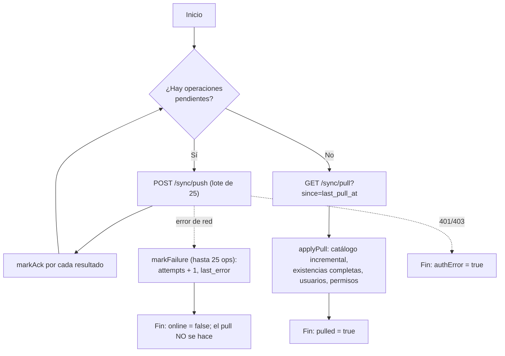

# Sincronización

> Revisión: 22/10/2026.
> **Qué está verificado y qué no.** Todo lo descrito está **leído del código**: el lado dispositivo en `packages/database/src/local-store.ts` y `packages/sync/src/*.ts`, y el lado servidor en `apps/api/src/sync-apply.ts`, `sync-payloads.ts`, `routes/sync.ts`, `pull.ts`, `stock.ts`. **Nada se ha ejecutado**: las únicas pruebas de sincronización existentes usan un servidor simulado en memoria (`packages/sync/test/sync.test.ts`), y la API real todavía no tiene pruebas con MongoDB (ver [README](../README.md), sección 0 y [PRUEBAS.md](PRUEBAS.md)).

## 1. La idea en lenguaje sencillo

- Cada venta, entrada de mercancía o movimiento de caja es un **evento** con un número de identificación único (`opId`).
- El equipo guarda el evento en su cola y lo envía al servidor cuando hay internet. Si lo envía dos veces, el servidor responde "ya lo tenía" (`duplicate`) y no lo cuenta dos veces.
- **Primero se envía todo lo pendiente y solo después se baja el catálogo y las existencias nuevas.** Así lo que baja ya incluye lo que acabas de subir, y nunca se pierde ni se duplica una venta local.
- Si una venta ya ocurrió en el mostrador (el cliente ya pagó y se llevó la mercancía), **jamás se rechaza por falta de existencias**: se registra, el inventario puede quedar en negativo y el gerente recibe un aviso para revisarlo.

## 2. Qué operaciones viajan

Tipos de `SyncOp` (`OpType`): `sale.create`, `sale.adjust` (cancelación o devolución), `stock.movement` (entrada, salida, ajuste, conteo), `cash.open`, `cash.movement`, `cash.close`.

**No viajan por la cola** (solo funcionan en línea): altas/ediciones de productos, cambios de precio, transferencias entre sucursales, gestión de usuarios y de permisos temporales.

Cada operación lleva: `opId`, `type`, `branchId`, `terminalId`, `userId`, `localTs` (hora del dispositivo) y `payload`.

## 3. La cola (`sync_queue`)

```mermaid
stateDiagram-v2
  [*] --> pendiente: la operación se guarda junto con su venta/movimiento (misma transacción)
  pendiente --> pendiente: falla de red o error 5xx/408/429 (attempts + 1, last_error)
  pendiente --> enviada: applied o duplicate
  pendiente --> conflicto: conflict (la operación SÍ se aplicó; hay diferencia para el gerente)
  pendiente --> rechazada: rejected (NO se aplicó; queda registrada para el gerente)
  enviada --> [*]
  conflicto --> [*]: el gerente lo resuelve (sync_conflicts)
  rechazada --> [*]: el gerente lo revisa
```

- El orden de envío es `seq` (autoincremental): se respeta el orden en que ocurrieron.
- Lotes de **25** operaciones (configurable); el servidor admite hasta **100** por petición (`syncPushSchema`).
- Un reintento tras una caída de red es seguro en cualquier punto: si el servidor ya había aplicado la operación y la respuesta se perdió, el reintento recibe `duplicate` y se confirma sin duplicar. *(Prueba escrita: "se corta la red DESPUÉS de que el servidor aplicó".)*
- Si un acuse llega repetido, `markAck` lo ignora (solo actúa sobre operaciones `pendiente`).
- Error 401/403: el ciclo informa `authError` (sesión vencida o sin permiso). **No** se interpreta como "sin internet": el usuario debe volver a iniciar sesión. Errores 5xx, 408, 429 y fallos de red sí se consideran "sin conexión" y se reintentan.
- Tiempo máximo de espera por petición: 30 segundos.

### Qué hace el cliente con cada respuesta (`markAck`)

| Respuesta del servidor | Estado en la cola | Estado de la venta/ajuste | Movimientos de inventario | Otros efectos |
|---|---|---|---|---|
| `applied` | `enviada` | `sincronizada` | `synced = 1` | — |
| `duplicate` | `enviada` | `sincronizada` | `synced = 1` | — |
| `conflict` | `conflicto` | `conflicto` | `synced = 1` | Se crea una fila en `sync_conflicts` |
| `rejected` | `rechazada` | `conflicto` | `synced = 1` (la existencia local vuelve a la verdad del servidor) | Se crea fila en `sync_conflicts`; el detalle queda en `last_error` |
| (cierre de caja) `applied`/`duplicate` | — | `reconciliation = 'conciliado'` | — | |
| (cierre de caja) `conflict`/`rejected` | — | `reconciliation = 'con_diferencias'` | — | |

## 4. Un ciclo de sincronización (`runSyncCycle`)

Reglas: el **pull solo se hace si la cola quedó vacía** (`remaining === 0`). Si el servidor no confirma ninguna operación de un lote, el ciclo se detiene para no entrar en un bucle infinito.

## 5. Cómo se calculan las existencias en el cliente

`cantidad visible = stock.base_qty + SUM(delta de movimientos locales con synced = 0)`

- El `pull` reemplaza `base_qty` pero **no toca los movimientos locales pendientes** → no se "restauran" cifras de la mañana. *(Prueba escrita: "los pulls del servidor no borran el efecto de ventas locales pendientes".)*
- Una venta de otra terminal aparece cuando llega un `pull` con la cifra nueva del servidor. *(Prueba escrita: "venta local durante la caída del servidor y ventas de otra terminal".)*
- **Limitación conocida (ventana de inflado):** al confirmarse una operación, sus movimientos pasan a `synced = 1` (dejan de restar) pero `base_qty` sigue siendo la cifra anterior hasta que se complete un `pull`. Si justo después del `push` se cae internet, la cantidad mostrada puede quedar **mayor** a la real hasta el siguiente ciclo exitoso. Es un riesgo de sobreventa leve; la pantalla debe mostrar "última sincronización" para que el operador lo tenga presente.

## 6. Reglas por situación

Antes del detalle, cómo responde el servidor a cada operación (`applySyncOp`):

1. Comprueba que la operación pertenece a la terminal (o al usuario) que hace la petición (`terminal_ajena`, `usuario_ajeno` → rechazada).
2. Inserta primero el "evento" (`sync_events`, `_id = opId`). Si ya existía y terminó → responde `duplicate`. Si quedó a medias por una caída del servidor (`procesando` más de 2 minutos o `error`) → lo **reprocesa** de forma segura (cada paso es idempotente).
3. Valida el contenido con Zod y **vuelve a calcular** los importes con la misma función que el dispositivo (`computeSale`).
4. **Lee del servidor** el rol, la sucursal y los permisos temporales; ignora lo que diga el dispositivo sobre autorizaciones (`grantId`, `authorizedBy`).
5. Resultado: `applied` (sin observaciones), `conflict` (**se aplicó**, pero hay una o más diferencias para el gerente) o `rejected` (**no se aplicó**; la operación original queda guardada en `sync_conflicts` para que el gerente la revise).

### Lista de hallazgos que genera el servidor

**Se aplica y avisa (`conflict`):**

| Código | Cuándo |
|---|---|
| `stock_negativo` | Una venta o movimiento dejó la existencia por debajo de cero |
| `precio_menor_catalogo` | Se vendió a un precio menor al del catálogo actual, sin descuento (puede deberse a un cambio de precio posterior) |
| `producto_desconocido` | La variante no existe en el servidor (no descontó existencias) |
| `descuento_sin_permiso` | Descuento hecho por un rol sin `ventas.descuento` |
| `usuario_inactivo` | El usuario fue desactivado en el servidor (la venta ya ocurrió) |
| `hora_futura` | La hora del dispositivo está más de 10 minutos adelantada |
| `folio_duplicado` | El folio ya existe en otra venta |
| `caja_desconocida` / `caja_otra_sucursal` | La venta o ajuste apunta a una caja que el servidor no conoce o es de otra sucursal |
| `venta_tras_corte` / `movimiento_tras_corte` | La operación es posterior al corte de su sesión de caja |
| `importe_ajuste_distinto` / `pagos_no_coinciden` | En una devolución/cancelación, el importe o los pagos no cuadran con el recálculo |
| `autorizacion_invalida` | **v2.** Un cierre de caja, cancelación, devolución o Limpia hecho por un vendedor trae una autorización que NO era válida a la hora local de la operación (token vencido/revocado/agotado/de otro propósito o sucursal, gerente inactivo o de otra sucursal, o token que se agotó en una carrera). La operación ya ocurrió: se aplica y se avisa |
| `conteo_difiere` | Un conteo físico no coincide con la existencia del servidor (hubo operaciones entre medio) |
| `caja_duplicada` | La terminal ya tenía otra caja abierta en el servidor |
| `corte_difiere` | El efectivo esperado del dispositivo no coincide con el que calcula el servidor (faltan o sobran operaciones por sincronizar) |

**Se rechaza (`rejected`, no se aplica):** `payload_invalido`, `payload_inconsistente`, `importes_inconsistentes`, `usuario_desconocido`, `sin_acceso_sucursal`, `sin_permiso`, `venta_no_encontrada`, `ya_cancelada`, `tiene_devoluciones`, `partida_invalida`, `devolucion_excedida`, `cancelacion_incompleta`, `delta_invalido`, `producto_no_encontrado`, `terminal_desconocida`, `sesion_no_encontrada`, `ya_cerrada`, `tipo_desconocido`, `terminal_ajena`, `usuario_ajeno`.

> **Aviso importante:** una venta puede ser **rechazada** si el servidor no logra reproducir sus importes (`importes_inconsistentes`), si el usuario no tiene acceso a esa sucursal o si el payload está mal formado. Es el caso más delicado, porque el cliente **ya cobró**. La venta sigue en la base del dispositivo (marcada `conflicto`) y la operación original queda guardada en el servidor, pero **no suma a las cifras del servidor** hasta que el gerente la atienda. Por eso el gerente debe revisar a diario los rechazos.

### 6.1 Ventas simultáneas (misma terminal)
El acceso a SQLite está serializado con un candado y cada venta es una transacción `BEGIN IMMEDIATE`. Ocho ventas lanzadas a la vez producen ocho folios distintos y un inventario consistente. *(Prueba escrita: "ventas simultáneas"; sin ejecutar.)* El consecutivo del folio sube dentro de la misma transacción: `AMA-<sucursal><terminal>-<aammdd>-<0001>`.

### 6.2 Ventas simultáneas (distintas terminales)
- Cada terminal tiene un **código único**, así que los folios no chocan.
- El servidor registra primero el movimiento de inventario (único por `_id`) y **después** hace `$inc` atómico en `stock`; así dos terminales que venden lo mismo suman correctamente. Si el resultado es negativo, la venta **igual se aplica** y genera `stock_negativo`.
- Si el proceso del servidor muere entre el movimiento y el `$inc`, `reconcileStock` recalcula las existencias sumando movimientos (ruta `POST /inventory/reconcile`; corrige solo si el valor no cambió mientras tanto, y si cambió lo deja para la siguiente pasada).
- El gerente ve el conflicto y decide (reponer, hacer un ajuste con motivo, investigar). **Nunca se borra la venta.**

### 6.3 Ajustes de inventario, entradas, salidas y conteos
- **Dispositivo:** nunca pisa la existencia: registra un movimiento con signo. El **conteo** guarda la *diferencia* entre lo contado y lo que el dispositivo creía tener.
- **Servidor:** exige `inventario.mover` (o permiso temporal vigente para entradas de un vendedor); comprueba que el signo del movimiento corresponda al tipo (`delta_invalido`); aplica `$inc`; si es un conteo y la existencia final no es lo contado → `conteo_difiere`.
- **Recomendación operativa:** hacer conteos físicos con todas las terminales sincronizadas y sin vender.

### 6.4 Transferencias entre sucursales
No son ventas ni pasan por la cola: se crean **en línea** (`POST /inventory/transfers`, permiso `transferencias.crear`) y generan una salida en el origen y una entrada en el destino. Llegan a los dispositivos como cambio de existencias en el siguiente `pull`. **Sin internet no se pueden registrar transferencias**: anótalas en papel y regístralas al volver la conexión.

### 6.5 Cancelaciones
- **Dispositivo:** solo el gerente. Crea un `sale_adjustment` de tipo `cancelacion` por el total, marca la venta `cancelada` (la venta original conserva sus importes) y devuelve la mercancía a existencias. No procede si ya tiene devoluciones, si ya está cancelada, o si no hay caja abierta y se pagó en efectivo.
- **Servidor:** exige `ventas.cancelar`; la venta debe existir y estar `completada`; sin devoluciones previas; la cancelación debe incluir **todas** las partidas completas. **Si dos terminales cancelan la misma venta**, la segunda se **rechaza** (`ya_cancelada`) y **no** vuelve a sumar existencias (el movimiento tiene un `_id` determinista). En la terminal que quedó rechazada, el efectivo ya devuelto físicamente sigue en su caja local pero no en la del servidor → ese corte saldrá con `corte_difiere`.
- Si la venta de origen aún no ha llegado al servidor, la cancelación se rechaza con `venta_no_encontrada`. Como la cola va **en orden** (`seq`) y una cancelación se crea después de su venta, normalmente llegan en el orden correcto.
- Por la API en línea, cancelar exige además reautenticación (`x-reauth`).

### 6.6 Devoluciones
- **Dispositivo:** solo el gerente. Se elige partida y cantidad; el importe usa redondeo acumulado para que varias devoluciones parciales nunca excedan el neto de la línea. Cada partida indica si **regresa a existencias** (`restock`) o es merma. Es un **registro nuevo**; no modifica la venta.
- **Servidor:** exige `ventas.devolver`; recalcula el importe (`importe_ajuste_distinto` si difiere); rechaza si se devuelve más de lo vendido (`devolucion_excedida`).

### 6.7 Cambios de precio
- **Dispositivo:** al vender, el precio y el costo salen del catálogo *local en ese instante* y quedan copiados en la partida y el ticket. Un cambio posterior del catálogo **no altera** ventas ni tickets anteriores. *(Prueba escrita.)*
- Si el gerente cambia el precio y una terminal desconectada aún tiene el viejo, **vende al precio viejo hasta su siguiente `pull`**.
- **Servidor:** la venta se registra con el precio con que se cobró (no se recalcula con el precio vigente). Si el precio cobrado es **menor** al del catálogo actual y no hubo descuento, genera el aviso informativo `precio_menor_catalogo`. Si fue **mayor** (bajó el precio después), no avisa.

### 6.8 Productos archivados
- **Dispositivo:** un producto o variante archivado en el catálogo local no se puede vender ni aparece en búsquedas o inventario.
- Si se archiva en el servidor mientras una terminal está desconectada, esa terminal aún lo ve activo y puede venderlo. **El servidor acepta la venta sin avisar** (no revisa si el producto está archivado; solo si existe). Al sincronizar, el producto aparece archivado en el dispositivo. Los tickets e informes históricos siguen mostrándolo (las partidas tienen copia del nombre).

### 6.9 Permisos temporales (entradas de mercancía)
- **Dispositivo:** la entrada de un vendedor requiere un permiso vigente (`inicio ≤ ahora < expiración`, misma sucursal, función `inventario.entrada`, no revocado) con la **hora local**; al caducar se bloquea. No sirve para salidas, ajustes, conteos ni cortes. En el teléfono hay además reglas más estrictas (ver [PERMISOS.md](PERMISOS.md)).
- **Servidor:** vuelve a evaluar el permiso con **sus propios registros** en la hora de la operación (la menor entre la hora del dispositivo y la hora actual del servidor, para que no se pueda "caer" en un permiso fingiendo una hora futura). Si no había permiso vigente → `sin_permiso` (**rechazada**: la entrada no se aplica y el gerente debe registrarla de otra forma). Las columnas `authorized_by` y `grant_id` las determina el servidor.
- Una **revocación** hecha por el gerente solo llega a un teléfono sin conexión en el siguiente `pull`. Una revocación posterior a la hora de la operación no invalida la entrada ya hecha. Conviene conceder permisos de **corta duración** (5 min – 24 h).

### 6.10 Operaciones duplicadas
- Tres capas: (1) la pantalla genera el `saleId` antes de cobrar y `registerSale` devuelve la venta existente si se repite; (2) la cola local tiene `op_id UNIQUE`; (3) el servidor responde `duplicate` por `opId` (`sync_events._id`) y además cada paso interno es idempotente por `_id`.
- Los movimientos manuales usan el UUID del formulario como `id`: repetir el mismo formulario devuelve `duplicate: true`.
- Aviso honesto: si una venta se **teclea dos veces como dos ventas distintas**, el sistema no puede saber que era un error; son dos ventas y habrá que cancelar una.
- Folio repetido (por ejemplo, tras restaurar un respaldo viejo): el servidor lo acepta pero lo marca `folio_duplicado` (ver [RESPALDOS.md](RESPALDOS.md), 4.3).

### 6.11 Cortes de caja
- **Dispositivo:** solo el gerente. Calcula el efectivo esperado, compara con lo contado y guarda la diferencia. Queda `provisional` si estaba sin conexión (`offline`) o si tenía **operaciones propias** pendientes; su `reconciliation` queda `pendiente`.
- **Servidor (`cash.close`):** exige `caja.corte`; **recalcula el esperado** con las operaciones que ya recibió (ignora el desglose del dispositivo); si difiere del que mandó el dispositivo → `corte_difiere` y el corte queda `con_diferencias` y `provisional`; si no, `conciliado`. También queda `provisional` si el servidor ve que la terminal tiene otros eventos todavía en proceso. Un corte duplicado de la misma sesión se rechaza (`ya_cerrada`).
- El dispositivo traduce la respuesta: `applied`/`duplicate` → `conciliado`; `conflict`/`rejected` → `con_diferencias`.
- Un corte cerrado **no se reabre ni se edita** (trigger local). Si algo está mal, se documenta con una nota/ajuste posterior; no se borra el corte.
- **Límites:** (a) `provisional` en el dispositivo solo considera **su propia cola**; no sabe si otra terminal desconectada tiene ventas sin enviar. (b) El esperado de una caja solo cuenta ventas, devoluciones y movimientos **de esa sesión** (una sesión por terminal). (c) Un corte es "conciliado" cuando el servidor y el dispositivo **coinciden** en el esperado; eso no garantiza que no existan ventas de otras terminales aún sin enviar (esas pertenecen a otras cajas).

### 6.12 Conflictos entre terminales
Se listan en `GET /admin/conflicts` (permiso `sync.conflictos`) y se resuelven con `POST /admin/conflicts/:id/resolve`. Para cada conflicto el gerente necesita: operación (`opId`, tipo), terminal, usuario, detalle y si **se aplicó o fue rechazada**. Resolver lo marca `resuelto` (quién, cuándo, resolución); **no modifica operaciones históricas**. Los conflictos tienen un `_id` determinista (`opId:código`), así que reprocesar una operación no duplica el aviso.

## 7. Qué se puede y qué NO se puede recuperar

| Situación | ¿Se recupera? |
|---|---|
| Se cae internet; todo sigue en la PC | **Sí.** Todo está en SQLite y se envía al volver. |
| Se cae el servidor o Atlas | **Sí.** Igual que arriba. |
| La PC se apaga con luz cortada en plena venta | **Sí**, lo ya confirmado (SQLite con `synchronous=FULL`). La venta en curso no confirmada se pierde y debe repetirse. |
| La PC se avería **pero el disco está sano** | **Sí**, si se saca el disco/archivo `.sqlite` (y su carpeta con los archivos `-wal`/`-shm`) y se abre en otra PC. |
| La PC se avería **después** de haber enviado | **Sí**, las ventas ya están en la nube. |
| La PC se avería **antes de enviar**, el disco se pierde, y el teléfono **nunca recibió** esas ventas | **NO.** Esas ventas solo existían en la PC. El teléfono no puede conocer lo que nunca recibió. Lo único que ayuda: el último **respaldo** (cada 2 h / diario) que esté en **otro** disco o USB — recupera hasta la hora del respaldo, no más —, los tickets impresos, y los comprobantes de tarjeta/transferencia. |
| El teléfono vinculado recibió la réplica LAN de la venta | **Sí**, quedó en el teléfono (`replicate`) y se enviará desde ahí. |
| El respaldo está en el mismo disco que murió | **NO.** Un respaldo local no protege contra la pérdida física del equipo. |
| Una venta se hizo en el teléfono y el teléfono se pierde antes de sincronizar | **NO**, salvo que se hubiera replicado a la PC. |
| Reloj de la PC mal puesto | Las ventas se guardan, pero con hora equivocada (`localTs`/`created_at`) y pueden caer en el día equivocado en los informes. Corregir el reloj; no se reescribe el pasado. |

La réplica a la PC y el respaldo reducen el riesgo, pero **no lo eliminan**. Mientras más tiempo pase sin conectarse a internet, mayor es lo que depende de un solo equipo.

## 8. Enlace teléfono ↔ PC

Ver el diagrama en [ARQUITECTURA.md](ARQUITECTURA.md). Resumen operativo:

- **Modo A (teléfono como escáner):** el teléfono envía la lectura a la PC (`/scan`); la PC responde si encontró el producto.
- **Réplica (`/replicate`):** el teléfono envía sus operaciones (ventas) a la PC por la red local; la PC las importa con `ingestRemoteSale`, **conservando `id` y folio**, una sola vez (`duplicate` si se repite). Quedan en la cola de la PC con `origin = 'lan'` para enviarlas al servidor.
- **Impresión remota (`/print`):** el teléfono pide a la PC imprimir las dos copias de un folio que la PC ya conoce.
- Seguridad: QR de un solo uso con caducidad, firma HMAC por petición, ventana de 60 s, nonce anti-repetición, revocación. *(Prueba escrita sin red real.)*
- Solo funciona con **PC y teléfono en la misma red local y la PC encendida**. Si la PC está averiada o apagada, no hay réplica ni impresión por esa vía.

## 9. Lista de comprobación para el gerente (cada día)

1. Al abrir: ¿la pantalla muestra una "última sincronización" de hoy?
2. ¿Hay operaciones **pendientes**, **rechazadas** o **conflictos abiertos**? Revisarlos.
3. Antes del corte: sincronizar todas las terminales si es posible.
4. Al cerrar: confirmar que el corte quedó `conciliado` (no `pendiente`).
